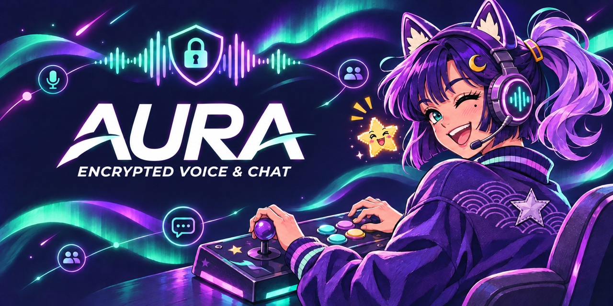

# Aura

**Self-hosted voice and text chat for small groups.** Run a server for your friends and give everyone a room to drop into during a game or while hanging out. Voice and text are end-to-end encrypted.

> **Pre-alpha.** Build from source to try it. Expect bugs and breaking changes. Keep sensitive conversations off Aura while it’s experimental. [Security review](docs/08_security_review.md)

## Try it

The native app runs on macOS. The .NET desktop client runs on Windows and Linux. Both offer push-to-talk, voice activation, and per-person volume and mute.

**[Run Aura locally](docs/QUICKSTART.md)** · [See the app](docs/images/channel.png) · [Roadmap](docs/ROADMAP.md)

## Project links

[Protocol](docs/protocol.md) · [Contributing](CONTRIBUTING.md) · [Report a security issue](SECURITY.md) · [Code of conduct](CODE_OF_CONDUCT.md) · [Apache 2.0 license](LICENSE)

Acknowledgments

Aura builds on [OpenMLS](https://github.com/openmls/openmls), [quinn](https://github.com/quinn-rs/quinn), [Opus](https://opus-codec.org/), [RNNoise](https://gitlab.xiph.org/xiph/rnnoise), [RustCrypto](https://github.com/RustCrypto), [aws-lc-rs](https://github.com/aws/aws-lc-rs), [dalek-cryptography](https://github.com/dalek-cryptography/curve25519-dalek), [UniFFI](https://github.com/mozilla/uniffi-rs), and [Avalonia](https://avaloniaui.net/). Aura adapts Discord’s [DAVE protocol](https://github.com/discord/dave-protocol), published under CC BY-NC-SA 4.0.

Parts of Aura were developed with AI assistance from Claude Code.

Copyright 2026 Jonathon Klobucar.

